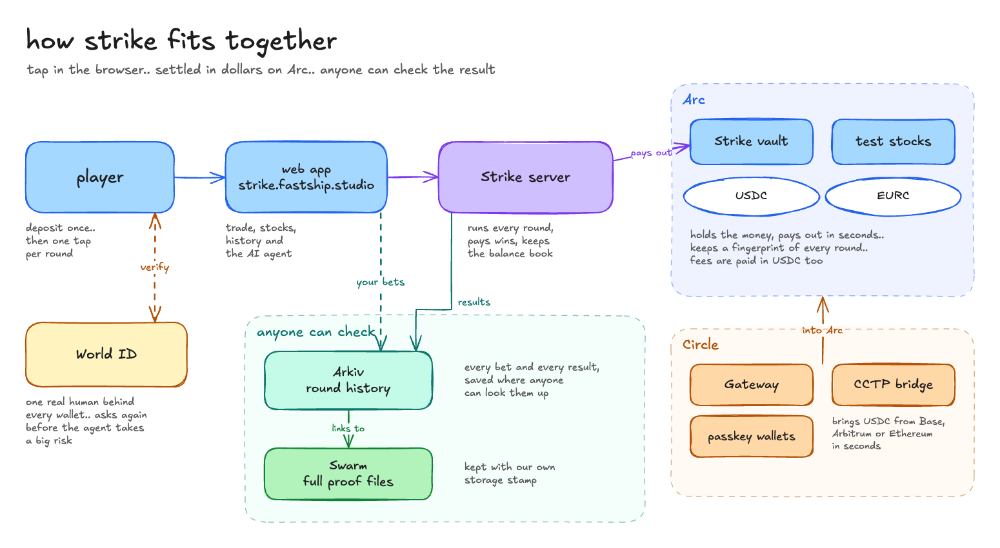

# Strike

higher or lower, five seconds to find out.. and every result can be checked by anyone

Strike is a binary options app on Arc. you call higher or lower on crypto, forex, stocks and metals in rounds of 5 seconds to 1 minute, settled in USDC or EURC. you deposit once and play from a balance, so a round needs no wallet popup.. and every bet and every result lands somewhere public, so you never have to trust us

**live:** [strike.fastship.studio](https://strike.fastship.studio) on Arc testnet · **how it works:** [strike.fastship.studio/arkiv](https://strike.fastship.studio/arkiv)



## at a glance

| | |
|---|---|
| live app | [strike.fastship.studio](https://strike.fastship.studio) on **Arc testnet** (chain id `5042002`) |
| Arc Studio project | [studio.arc.io/app/3466b6f3-8cdb-436f-a47b-2eb0d379c4dd](https://studio.arc.io/app/3466b6f3-8cdb-436f-a47b-2eb0d379c4dd) |
| vault | `StrikeTreasury` [`0x8726144B6a122862B9F1184752d8ebA0AcD662B6`](https://explorer.testnet.arc.io/address/0x8726144B6a122862B9F1184752d8ebA0AcD662B6) |
| stocks | `TestStockMarket` [`0xd9f98f3b268e788f3ccf6e7ced2d592a84a6f80f`](https://explorer.testnet.arc.io/address/0xd9f98f3b268e788f3ccf6e7ced2d592a84a6f80f) |
| a payout | [`0x9e98fd2e…5465`](https://explorer.testnet.arc.io/tx/0x9e98fd2ebea3c4518f31843fee79102fdc7f034c0f23a413e954143c08935465) |
| a batch of rounds committed | [`0xb51687e2…5712`](https://explorer.testnet.arc.io/tx/0xb51687e2490c4b9947674915480a950e11c80980f14ec1a49f3b4bc505dc5712) |
| check any round | [strike.fastship.studio/verify](https://strike.fastship.studio/verify) |
| packages we published | [arkiv-rs-sdk](https://crates.io/crates/arkiv-rs-sdk) on crates.io, [arc-provable-vault](https://github.com/TryStrike/arc-provable-vault) template |
| builder | [github.com/ayuxy027](https://github.com/ayuxy027) |

every contract, tx and Studio detail for the Arc track: [docs/arc.md](docs/arc.md)

## what's in here

| track | what to read |
|---|---|
| Arc, Best DeFi / Onchain Finance App Built End to End in Arc Studio | [docs/arc.md](docs/arc.md) |
| Arkiv, Build on Arkiv (from scratch) | [arkiv/](arkiv/): [schema](arkiv/schema.md), [how we use Arkiv](arkiv/how-you-use-arkiv.md), [why Arkiv](arkiv/why-arkiv.md), [reach](arkiv/reach.md), [friction](arkiv/friction.md) |
| Arkiv + Swarm bonus | [arkiv/swarm.md](arkiv/swarm.md) |
| World ID Agent Pass, Best Use of IDKit | [docs/world.md](docs/world.md), [docs/world-debrief.md](docs/world-debrief.md) |

**we built the missing Rust SDK.** Arkiv had no Rust SDK, so we wrote our own encoder for Strike's backend, then turned it into [arkiv-rs-sdk](https://github.com/TryStrike/arkiv-rs-sdk), published on [crates.io](https://crates.io/crates/arkiv-rs-sdk): open source (MIT), with typed attributes, batched writes that stay under the node's size limit, queries, and retries. its tests check it byte for byte against the official TypeScript SDK and against what Strike writes in production

**and a vault anyone can reuse.** the contract behind Strike's money is now a template for other Arc builders: [arc-provable-vault](https://github.com/TryStrike/arc-provable-vault), capped stablecoin payouts with provable results, MIT

## Arkiv: who writes, and one query to run

| writer | writes | address |
|---|---|---|
| Strike operator | every settled round (`strike.rounds`) and every 10 minute batch (`strike.epochs`) | `0x0f05df479fcb23b2281e28813fb47e57e47d1bb7` |
| each player's browser key | that player's own bets (`strike.bets`), with the wallet's signature that allowed the key stored on every entity | one key per player, list them with the second query below |

every settled round by the Strike operator, on Bitcoin:

```bash
curl -s https://rpc.rabdi.db-chain.testnet.arkiv.network \
  -H 'content-type: application/json' \
  -d '{"jsonrpc":"2.0","id":1,"method":"arkiv_query","params":["arkiv.schema = str('"'"'strike.rounds'"'"') AND $creator = addr(0x0f05df479fcb23b2281e28813fb47e57e47d1bb7) AND asset = str('"'"'BTC'"'"')",{"select":{"key":true,"creator":true,"attributes":true},"limit":"0xa"}]}'
```

bets written by players themselves (each `creator` is a player's browser key):

```bash
curl -s https://rpc.rabdi.db-chain.testnet.arkiv.network \
  -H 'content-type: application/json' \
  -d '{"jsonrpc":"2.0","id":1,"method":"arkiv_query","params":["arkiv.schema = str('"'"'strike.bets'"'"')",{"select":{"key":true,"creator":true,"attributes":true},"limit":"0xa"}]}'
```

and to check a whole batch end to end, Arkiv to Swarm to Arc, without any Strike server:

```bash
cd frontend && npm ci && cd ..
node --experimental-strip-types scripts/verify-epoch.mjs 0x59c5ddf06b5605e27833d0a02c8f6e96cebf9f334a6470b39e31eccb34895807
```

## run it

```bash
cp .env.example .env.local                                   # one env file drives everything
(cd frontend && npm install)
cargo run --manifest-path backend/Cargo.toml -p server       # API on 127.0.0.1:8080
cd frontend && npm run dev                                   # app on http://localhost:3000
```

`.strike/check.sh all` runs fmt, clippy, the tests, the typecheck and a production build. contract tests: `forge test` from the root

## stack

Rust (axum) over a SQLite ledger, Next.js 16 with wagmi and viem, Solidity contracts on Arc, Arkiv over JSON-RPC, our own Swarm Bee node, Circle Gateway, CCTP via Bridge Kit and passkey wallets, World ID with IDKit and Agent Pass

## how we used AI

we used Claude Code for coding help and debugging, and Firecrawl for research (docs, partner APIs, similar projects). the idea, the design and the product calls were ours, and we reviewed and tested everything that went in

## license

[MIT](LICENSE)
