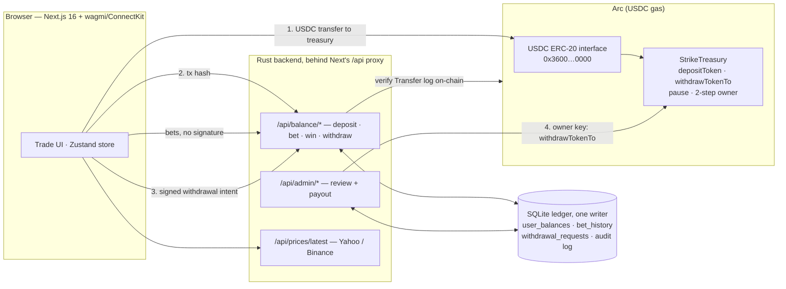
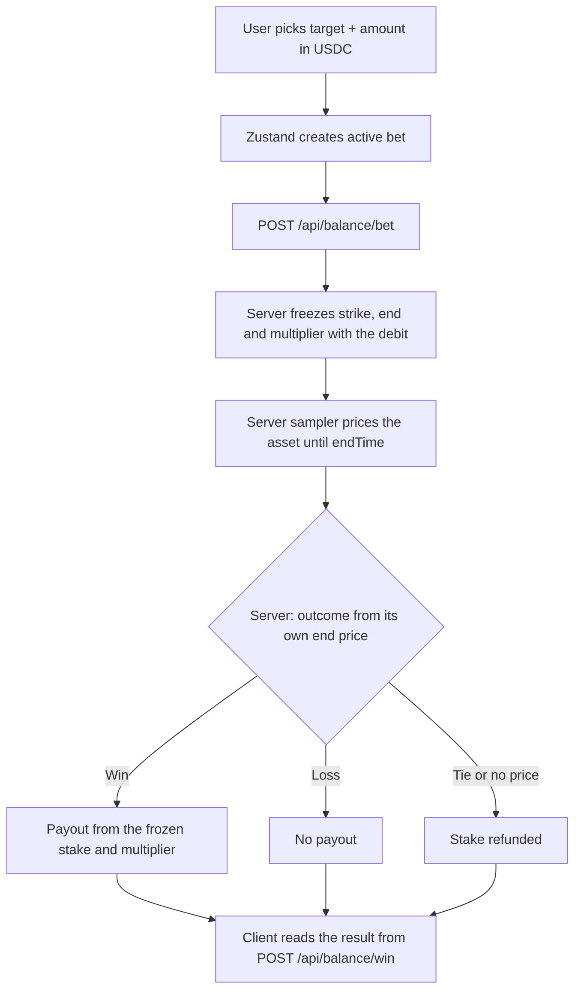
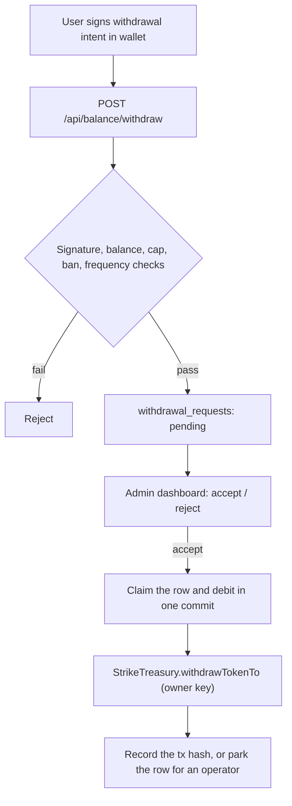

# Strike on Arc

> Binary options on **Arc** — USDC settlement, live-price settlement, no per-bet wallet signature.

| | |
|---|---|
| **Live (Arc Testnet)** | https://ethglobalmumbai.vercel.app/ |
| **Trade** | https://ethglobalmumbai.vercel.app/trade |
| **Arc Studio** | https://studio.arc.io/app/3466b6f3-8cdb-436f-a47b-2eb0d379c4dd |
| **Treasury (testnet)** | [`0xea76bc5a87114d8a6a85f4dfd6c48c5e688a9871`](https://explorer.testnet.arc.io/address/0xea76bc5a87114d8a6a85f4dfd6c48c5e688a9871) |
| **Deck** | [Google Slides](https://docs.google.com/presentation/d/1gPwWqA6F5mqtdAjCApLNCzE-zLr99AYG1fzq4zLuQyY/edit?usp=sharing) |
| **GitHub** | https://example.com/strike |

This repo settles on **Arc only**. Players deposit **USDC**, trade binary rounds against a house balance, and withdraw on-chain. Other networks are not supported.

---

## ETHGlobal Mumbai

Tracks: Arc (main), World ID Agent Pass. Architecture: [`docs/architecture.md`](docs/architecture.md). Demo order: [`docs/demo-script.md`](docs/demo-script.md).

**Arc Studio project:** https://studio.arc.io/app/3466b6f3-8cdb-436f-a47b-2eb0d379c4dd

### Before and during the hackathon

Hacking starts Nov 5, 21:00 IST. Commit dates in `git log` are the record.

Strike was a working binary options dapp ported across several chains, most recently BOT Chain (native BOT + USDT), with about ten network integrations, a staking product and a treasury built for a native coin plus an ERC-20.

Before kickoff:

- **Oct 26, Arc port.** Pruned to Arc only (every other chain, staking, ~26.8k lines of dead code). USDC-only `StrikeTreasury` with `depositToken`, `withdrawTokenTo`, batched payouts, pause and two-step ownership. USDC moves only through the 6 decimal ERC-20 interface.
- **Oct 31 to Nov 1.** Backend moved from Next routes to Rust (axum) and SQLite.
- **Nov 3, merged to `main` at `a78c7d2`.** Agent engine (normal and YOLO), copilot, capped operator treasury with payout refs, CCTP and round proofs.
- **Nov 5, 01:51 to 02:47 IST, branch `feat/side-tracks` (`c90aa13..eb16b39`).** World ID step-up gate for YOLO, epoch Merkle commits and `/api/proofs/*`, the World chip, the onchain proof block and the epoch strip.

During the event: `TODO` list the commits after Nov 5, 21:00 IST with their range (`git log --since="2026-11-05 21:00 +0530"`).

### World ID: human-backed YOLO

**What.** A YOLO agent spends USDC with no tap per trade. It starts only after a live human approves in World App. One human, one YOLO agent. Bans follow the human across wallets. Normal mode, where every trade waits for a tap, needs no World.

**How.** Plain OIDC against World IdP (authorization code, PKCE S256, `max_age=0` step-up), all in Rust:

- `POST /api/agent/start` in YOLO mode saves a pending attempt and answers `401` with `WWW-Authenticate` and the World authorize URL.
- The nonce is `sha256(attempt id + signed start message)`, so an approval is for those exact terms only.
- `GET /api/world/callback` swaps the code with the client secret and verifier, checks RS256 against World's JWKS, `iss`, `aud`, `exp`, `nonce`, `auth_time` and `acr`.
- One write checks the attempt is still pending, the same human owns the wallet, no linked wallet is banned and the human runs no other YOLO, then creates the session.
- The required proof grows with the budget: selfie up to `WORLD_SELFIE_MAX` (10), Orb up to `WORLD_ORB_MAX` (50), Orb plus a live face above.
- Cancel, expiry, another browser, another human, a banned human, a second YOLO or too low an assurance leave no session and no bet. `GET /api/world/attempts/{id}` drives the chip on `/agent`.
- Human checkpoint: once a YOLO agent loses half its stop-loss it pauses with "Waiting for a human" and places nothing. `POST /api/agent/checkpoint` returns the same `401` step-up, pinned to the linked human's `sub`. Approval resumes it in one write. Cancel, another human, a ban or 2 minutes with no answer stops it.
- After approval the agent loop never calls World. It only reads checkpoint results from the DB.

**Where.** `backend/crates/core/src/world.rs`, `backend/crates/server/src/routes/world.rs`, `backend/crates/server/src/routes/agent.rs`, `frontend/lib/agent/useAgent.ts`, `frontend/components/agent/AgentPanel.tsx`. Tables `world_attempts` and `world_links` in `backend/crates/core/src/db.rs`.

**Run.** Register a client at https://auth.world.org/portal with the exact HTTPS callback, then set `WORLD_ISSUER`, `WORLD_CLIENT_ID`, `WORLD_CLIENT_SECRET` and `WORLD_REDIRECT_URI` in the root `.env.local` (see `.env.example`). Without them YOLO start answers `503`. Open `/agent`, pick YOLO, sign. Unit tests: `cargo test --manifest-path backend/Cargo.toml -p strike-core --lib world::`.

Debrief: [`docs/world-debrief.md`](docs/world-debrief.md).

### Settlement proofs on Arc

Every 10 minutes, after the epoch closes plus 60 s, the Rust committer sends `StrikeTreasury.commitRounds(epoch, root, count)`. The root is a sorted-pair Merkle root over one leaf per settled round. `GET /api/proofs/bet/{id}` returns the bet's leaf and Merkle proof, and the proof modal folds it to the committed root in the browser. `/history` lists the latest committed epochs with their Arc tx.

**Where.** `backend/crates/core/src/proofs.rs`, `backend/crates/server/src/routes/proofs.rs`, `frontend/components/game/OnchainProof.tsx`, `frontend/components/history/EpochStrip.tsx`. Set `PROOFS_START_EPOCH` so the committer never backfills history.

---

## Table of Contents

1. [Overview](#overview)
2. [Arc](#arc)
3. [How it works](#how-it-works)
4. [Game modes](#game-modes)
5. [Treasury contract](#treasury-contract)
7. [Fees](#fees)
8. [Tech stack](#tech-stack)
9. [Architecture](#architecture)
10. [Schema](#schema)
11. [API](#api)
12. [Admin dashboard](#admin-dashboard)
13. [Directory structure](#directory-structure)
14. [Environment variables](#environment-variables)
15. [Local development](#local-development)
16. [Contracts](#contracts)
17. [Deployment](#deployment)
18. [Security](#security)

---

## Overview

Strike is a fast binary options dapp that lives entirely on Arc.

- Deposit USDC to the `StrikeTreasury` contract.
- Trade 5s / 10s / 15s / 30s / 1m rounds without signing a transaction per bet.
- Outcomes resolve from **live price feeds (Yahoo/Binance)** price feeds.
- Wins and losses update an in-house balance; withdrawals go back on-chain.

Playable asset: **USDC** (6 decimals). Markets cover crypto, forex, stocks, metals, and commodities via live price feeds.

---

## Arc

| | Mainnet | Testnet |
|---|---|---|
| **Chain ID** | `5042` | `5042002` |
| **RPC** | `https://rpc.mainnet.arc.io` | `https://rpc.testnet.arc.io` |
| **Explorer** | https://explorer.arc.io | https://explorer.testnet.arc.io |
| **USDC (ERC-20 interface, 6 dp)** | `0x3600000000000000000000000000000000000000` | `0x3600000000000000000000000000000000000000` |
| **Faucet** | — | https://faucet.circle.com |
| **Treasury** | `NEXT_PUBLIC_TREASURY_ADDRESS` (StrikeTreasury) | `NEXT_PUBLIC_TREASURY_ADDRESS` (StrikeTreasury) |

Testnet is the default; set the `NEXT_PUBLIC_ARC_*` variables to point elsewhere.

On Arc, native USDC (the gas token, 18 decimals) and the USDC ERC-20 interface (6 decimals) are **the same balance**. Strike only moves USDC through the ERC-20 interface so amounts are never mis-scaled.

**Wallets:** MetaMask, Trust Wallet and WalletConnect (wagmi + ConnectKit). The app switches the connected wallet onto Arc on connect.

Config lives in `frontend/lib/arc/config.ts` and `backend/crates/core/src/config.rs`.

---

## How it works

```
1. Connect a wallet on Arc
2. Deposit USDC to StrikeTreasury
3. House balance is credited (off-chain, in the SQLite ledger)
4. Place bets — no wallet signature per round
5. Live price at expiry settles the outcome
6. Withdraw back to the same Arc address
```

Deposits and withdrawals are on-chain. Bets, wins, and losses are atomic house-balance RPCs so rounds can settle in milliseconds.



---

## Game modes

### Classic

Pick UP or DOWN, a multiplier tile, and an expiry. Win if the live price at `endTime` is above (UP) or below (DOWN) the strike at bet placement.

### Box

The live chart shows a grid of price-band tiles. Win if the price line tip is inside the selected band when it reaches the tile’s start time. Tighter bands pay higher multipliers.

### Draw

Draw a rectangle on the chart. Win if price stays inside that band for the full window. Smaller, farther, shorter boxes pay more.

### Blitz

Pay a one-time entry fee to the fee collector during the active window. All multipliers are boosted **2×** while Blitz is live (1 min on, 2 min cooldown).

| Asset | Entry fee |
|-------|-----------|
| USDC | 1 USDC |

---

## Treasury contract

`contracts/StrikeTreasury.sol` is the house vault. It holds the playable asset (USDC). Players deposit; the operator pays withdrawals and winnings after off-chain settlement.

Why a contract instead of an EOA:

- **`pause()`** stops deposits and payouts immediately if a key is compromised.
- **Two-step ownership** — the nominee must call `acceptOwnership()`, so a mistyped address cannot lock the treasury.

Events (`Deposited`, `Withdrawn`) are the on-chain audit trail used to reconcile the house ledger.

See [`contracts/README.md`](contracts/README.md) for deploy addresses and owner.

---

## Fees

Tiered on every deposit and withdrawal. The fee is sent from the treasury to `NEXT_PUBLIC_PLATFORM_FEE_WALLET_ARC`.

| Tier | Fee |
|------|-----|
| free | 10% |
| standard | 9% |
| vip | 8% |

Net amount is what is credited on deposit or sent on withdrawal. Blitz entry fees are a separate flat transfer to the same collector.

---

## Tech stack

| Layer | Stack |
|-------|--------|
| Frontend | Next.js 16 App Router, React 19, TypeScript, Tailwind v4, Zustand, TanStack Query |
| Arc | wagmi 3 + viem 2 + ConnectKit, ethers 6 |
| Backend | Rust (axum) service in `backend/`, SQLite in WAL mode |
| Oracle | live price feeds (Yahoo/Binance) |
| Contracts | Solidity (`StrikeTreasury`) |
| Tooling | cargo test, ESLint |

---

## Architecture

Whole system with World and the settlement proofs, plus sequence diagrams: [`docs/architecture.md`](docs/architecture.md).

### State (Zustand — `lib/store/`)

| Slice | Responsibility |
|-------|----------------|
| `walletSlice` | Address, USDC currency, connect state |
| `gameSlice` | Mode, active/settled bets, price feed, Blitz |
| `balanceSlice` | House balance, deposit/withdraw |
| `historySlice` | Local bet history |
| `referralSlice` | Referral code |

Combined as `useStore` in `lib/store/index.ts`.

### Arc modules (`lib/arc/`)

| File | Role |
|------|------|
| `config.ts` | Arc chain ID, RPC, explorer, USDC address, treasury, and assets |
| `wagmi.ts` | Single-chain wagmi config (`arc`) |
| `client.ts` | Browser deposits and balance reads (USDC) |

### Bet lifecycle



### Withdrawal flow



---

## Schema

### Tables

| Table | Purpose |
|-------|---------|
| `user_balances` | PK `(user_address, currency)` — USDC house balance, tier, status |
| `balance_audit_log` | deposit, withdrawal, bet_placed, bet_won, bet_lost, platform_fee, refund, … |
| `bet_history` | Settled real-mode bets |
| `user_referrals` | Referral codes and counts |
| `user_sessions` | Dwell time |
| `withdrawal_requests` | Manual approval queue |

The schema is `backend/schema.sql`, and `PRAGMA user_version` tracks changes after it (`MIGRATIONS` in `backend/crates/core/src/db.rs`). Only the backend writes the file.

---

## API

### Balance

| Method | Route | Purpose |
|--------|-------|---------|
| `GET` | `/api/balance/[address]` | Balances for a Arc address |
| `POST` | `/api/balance/deposit` | Verify on-chain tx, credit net house balance |
| `POST` | `/api/balance/withdraw` | Signed intent → treasury payout |
| `POST` | `/api/balance/bet` | Deduct stake |
| `POST` | `/api/balance/win` | Credit win (dedup on `betId`) |
| `POST` | `/api/balance/session` | HttpOnly cookie for balance mutations |

Deposits are verified against the Arc RPC (`verify_deposit` in `backend/crates/core/src/eth.rs`).

### Bets

| Method | Route | Purpose |
|--------|-------|---------|
| `GET` | `/api/bets/history` | User history |
| `GET` | `/api/bets/recent` | Recent rounds |
| `GET` | `/api/bets/[id]` | Settlement proof for one round |

Admin routes live under `/api/admin/*` (auth, stats, ledger, treasury balances, withdrawal queue).

---

## Admin dashboard

`/dashboard` — every `/api/admin/*` route requires the admin session cookie.

Wallet Intel, Ledger, Player P&L, Gameplay, Financials (including withdrawal Accept/Reject), Inventory, Referrals, Danger Zone. Treasury snapshots read USDC on Arc.

---

## Directory structure

```
├── .strike/                    # git hooks and check.sh
├── frontend/                   # Next.js app
│   ├── app/                    # App Router pages
│   ├── components/             # game, wallet, balance, history, ui
│   ├── lib/                    # store, arc config, helpers
│   └── public/                 # market logos
│
├── backend/                    # Rust API (axum + SQLite), schema.sql, deploy/
├── contracts/                  # StrikeTreasury.sol, deploy
└── docs/                       # prd, ops, pitch deck
```

---

## Environment variables

One `.env.local` at the repo root drives the backend, the frontend and the contract deploy. `.env.example` lists every variable with its default. Arc Testnet is the default, so a local run needs only the treasury address and key, `SQLITE_PATH`, the two balance secrets and `DASHBOARD_PASSWORD`. `ARC_TREASURY_SECRET_KEY` must own `NEXT_PUBLIC_TREASURY_ADDRESS`.

---

## Local development

```bash
cp .env.example .env.local        # one env file at the root for everything
(cd frontend && npm install)      # also wires the git hooks in .strike
cargo run --manifest-path backend/Cargo.toml -p server   # Rust API on 127.0.0.1:8080
cd frontend && npm run dev        # in another shell
```

App: http://localhost:3000. Next proxies `/api/*` to the Rust service, so both must run. `next dev` assumes port 8080; `next build` requires `BACKEND_URL`.

```bash
.strike/check.sh all      # fmt, clippy, tests, typecheck, next build
```

Running it in production: `docs/OPERATIONS.md`.

`docs/CONTRIBUTING.md` covers PR expectations.

---

## Contracts

```bash
cd contracts && npm install && ARC_TREASURY_SECRET_KEY=... ARC_USDC_ADDRESS=0x... npm run deploy
```

---

## Deployment

Vercel (Next.js App Router) — production: https://ethglobalmumbai.vercel.app/

Set the Arc env vars in the project. `next.config.ts` applies CSP, `X-Frame-Options`, COOP, and CORS. Type errors block the build.

---

## Security

- Signed withdrawal intents on Arc (replay protection)
- Duplicate payout guard: `betId` checked in `balance_audit_log`
- Treasury `pause()` and two-step ownership
- The browser has no database access. Every read and write goes through a typed backend route
- Admin routes behind `requireAdminAuth`
- Balance mutation routes gated by session cookie / `BALANCE_INTERNAL_SECRET`

Report issues via `docs/SECURITY_REPORTING.md`.
