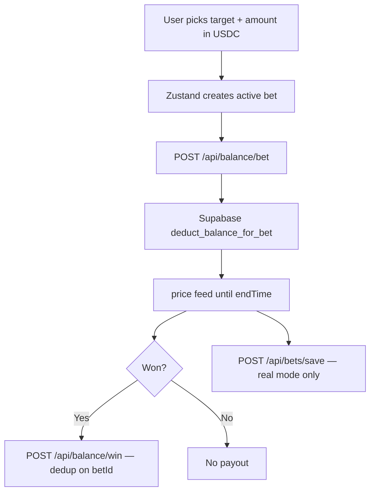
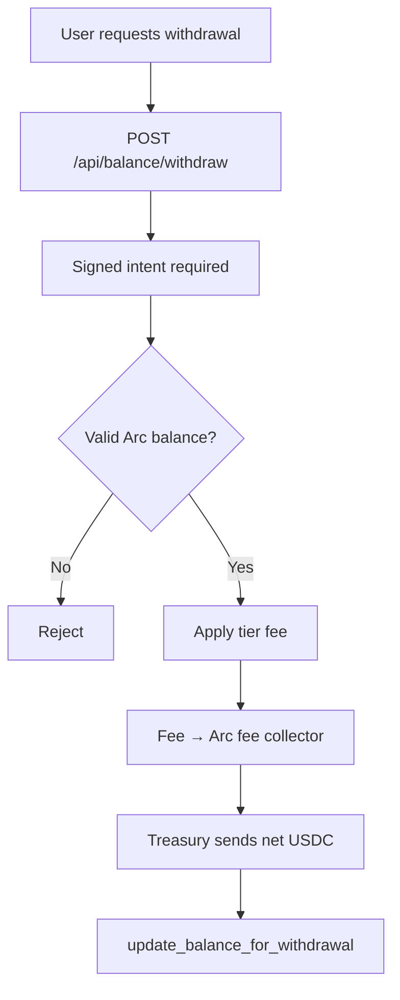

# Strike on Arc

> Binary options on **Arc** — USDC settlement, live-price settlement, no per-bet wallet signature.

| | |
|---|---|
| **Live** | https://ethglobalmumbai.vercel.app/ |
| **Trade** | https://ethglobalmumbai.vercel.app/trade |
| **Deck** | [Google Slides](https://docs.google.com/presentation/d/1gPwWqA6F5mqtdAjCApLNCzE-zLr99AYG1fzq4zLuQyY/edit?usp=sharing) |
| **GitHub** | https://example.com/strike |
| **Explorer** | https://explorer.arc.io |
| **RPC** | https://rpc.mainnet.arc.io |
| **Treasury** | Configure `NEXT_PUBLIC_TREASURY_ADDRESS` locally or in the deployment environment. |

This repo settles on **Arc only**. Players deposit **USDC**, trade binary rounds against a house balance, and withdraw on-chain. Other networks are not supported.

---

## Table of Contents

1. [Overview](#overview)
2. [Arc](#arc)
3. [How it works](#how-it-works)
4. [Game modes](#game-modes)
5. [Treasury contract](#treasury-contract)
7. [Fees](#fees)
8. [Tech stack](#tech-stack)
9. [Architecture](#architecture)
10. [Schema](#schema)
11. [API](#api)
12. [Admin dashboard](#admin-dashboard)
13. [Directory structure](#directory-structure)
14. [Environment variables](#environment-variables)
15. [Local development](#local-development)
16. [Contracts](#contracts)
17. [Deployment](#deployment)
18. [Security](#security)

---

## Overview

Strike is a fast binary options dapp that lives entirely on Arc.

- Deposit USDC to the `StrikeTreasury` contract.
- Trade 5s / 10s / 15s / 30s / 1m rounds without signing a transaction per bet.
- Outcomes resolve from **live price feeds (Yahoo/Binance)** price feeds.
- Wins and losses update an in-house balance; withdrawals go back on-chain.

Playable asset: **USDC** (6 decimals). Markets cover crypto, forex, stocks, metals, and commodities via live price feeds.

---

## Arc

| | Mainnet | Testnet |
|---|---|---|
| **Name** | Arc | Arc testnet |
| **Chain ID** | `5042` | Configure `NEXT_PUBLIC_ARC_CHAIN_ID` |
| **RPC** | `https://rpc.mainnet.arc.io` | Configure `NEXT_PUBLIC_ARC_RPC_ENDPOINT` |
| **Explorer** | https://explorer.arc.io | Configure `NEXT_PUBLIC_ARC_EXPLORER` |
| **USDC** | Configure `NEXT_PUBLIC_ARC_USDC_ADDRESS` when applicable | Address is not assumed |
| **Treasury** | Configure `NEXT_PUBLIC_TREASURY_ADDRESS` | Configure `NEXT_PUBLIC_TREASURY_ADDRESS` |

**Wallets:** MetaMask, Trust Wallet, WalletConnect (wagmi + ConnectKit), and Privy social login (embedded EVM wallet). The app switches the connected wallet onto Arc on connect.

Config lives in `lib/arc/config.ts` for compatibility with existing internal imports. Arc values use `NEXT_PUBLIC_ARC_*` variables.

---

## How it works

```
1. Connect a wallet on Arc
2. Deposit USDC to StrikeTreasury
3. House balance is credited (off-chain, Supabase)
4. Place bets — no wallet signature per round
5. Live price at expiry settles the outcome
6. Withdraw back to the same Arc address
```

Deposits and withdrawals are on-chain. Bets, wins, and losses are atomic house-balance RPCs so rounds can settle in milliseconds.

```
┌─────────────────────────────────────────────────────────────┐
│  OFF-CHAIN (Supabase)                                       │
│  user_balances  ·  balance_audit_log  ·  bet_history        │
│  user_sessions  ·  withdrawal_requests                      │
└─────────────────────────────────────────────────────────────┘
         ▲                            ▲
         │ balance RPCs               │ session pings
┌────────┴────────────────────────────┴────────────────────────┐
│  CLIENT (Next.js + Zustand + wagmi)                          │
│  Price feed: live price feeds (Yahoo/Binance)                                     │
│  Asset: USDC                                                 │
│  Network: Arc only                                           │
└──────────────────────────────────────────────────────────────┘
         ▲
         │ deposits / withdrawals
┌────────┴─────────────────────────────────────────────────────┐
│  ARC (5042)                                                  │
│  StrikeTreasury holds USDC                                   │
│  Fee collector receives platform + Blitz fees                │
└──────────────────────────────────────────────────────────────┘
```

---

## Game modes

### Classic

Pick UP or DOWN, a multiplier tile, and an expiry. Win if the live price at `endTime` is above (UP) or below (DOWN) the strike at bet placement.

### Box

The live chart shows a grid of price-band tiles. Win if the price line tip is inside the selected band when it reaches the tile’s start time. Tighter bands pay higher multipliers.

### Draw

Draw a rectangle on the chart. Win if price stays inside that band for the full window. Smaller, farther, shorter boxes pay more.

### Blitz

Pay a one-time entry fee to the fee collector during the active window. All multipliers are boosted **2×** while Blitz is live (1 min on, 2 min cooldown).

| Asset | Entry fee |
|-------|-----------|
| USDC | 1 USDC |

### Demo

Full simulation of every mode with a local balance. No wallet required. Demo bet IDs are prefixed `demo-*` and never written to `bet_history`.

---

## Treasury contract

`contracts/arc/StrikeTreasury.sol` is the house vault. It holds the playable asset (USDC). Players deposit; the operator pays withdrawals and winnings after off-chain settlement.

Why a contract instead of an EOA:

- **`pause()`** stops deposits and payouts immediately if a key is compromised.
- **Two-step ownership** — the nominee must call `acceptOwnership()`, so a mistyped address cannot lock the treasury.

Events (`Deposited`, `Withdrawn`) are the on-chain audit trail used to reconcile the house ledger.

See [`contracts/arc/README.md`](contracts/arc/README.md) for deploy addresses, e2e coverage, and owner.

---

## Fees

Tiered on every deposit and withdrawal. The fee is sent from the treasury to `NEXT_PUBLIC_PLATFORM_FEE_WALLET_ARC`.

| Tier | Fee |
|------|-----|
| free | 10% |
| standard | 9% |
| vip | 8% |

Net amount is what is credited on deposit or sent on withdrawal. Blitz entry fees are a separate flat transfer to the same collector.

---

## Tech stack

| Layer | Stack |
|-------|--------|
| Frontend | Next.js 16 App Router, React 19, TypeScript, Tailwind v4, Zustand, TanStack Query |
| Arc | wagmi 3 + viem 2 + ConnectKit, ethers 6, Privy |
| Backend | Next.js Route Handlers, Supabase (Postgres + RPCs) |
| Oracle | live price feeds (Yahoo/Binance) |
| Contracts | Solidity (`StrikeTreasury`) |
| Tooling | Jest, ESLint, PostHog |

---

## Architecture

### State (Zustand — `lib/store/`)

| Slice | Responsibility |
|-------|----------------|
| `walletSlice` | Address, USDC currency, real vs demo |
| `gameSlice` | Mode, active/settled bets, price feed, Blitz |
| `balanceSlice` | House balance, deposit/withdraw, demo balance |
| `historySlice` | Local bet history |
| `referralSlice` | Referral code |
| `profileSlice` | Username / profile |

Combined as `useStore` in `lib/store/index.ts`.

### Arc modules (`lib/arc/`)

| File | Role |
|------|------|
| `config.ts` | Arc chain ID, RPC, explorer, USDC address, treasury, and assets |
| `wagmi.ts` | Single-chain wagmi config (`arc`) |
| `client.ts` | Browser deposits and balance reads (USDC) |
| `backend-client.ts` | Server-only treasury transfers |

### Bet lifecycle



### Withdrawal flow



---

## Schema

### Tables

| Table | Purpose |
|-------|---------|
| `user_balances` | PK `(user_address, currency)` — USDC house balance, tier, status |
| `balance_audit_log` | deposit, withdrawal, bet_placed, bet_won, bet_lost, platform_fee, refund, … |
| `bet_history` | Settled real-mode bets |
| `user_profiles` / `user_referrals` | Username and referrals |
| `access_codes` / `waitlist` / `user_sessions` | Onboarding and dwell time |
| `withdrawal_requests` | Manual approval queue |

Arc defaults `user_balances.currency` to `'USDC'`. See `db/arc.sql`.

### RPCs

| Function | Purpose |
|----------|---------|
| `update_balance_for_deposit` | Credit deposit + audit |
| `deduct_balance_for_bet` | Deduct stake + audit |
| `credit_balance_for_payout` | Credit win + audit |
| `update_balance_for_withdrawal` | Deduct withdrawal + audit |
| `increment_referral_count` | Referral counter |

RLS is on; the app writes with the **service role** server-side. Migrations: `supabase/migrations/`.

---

## API

### Balance

| Method | Route | Purpose |
|--------|-------|---------|
| `GET` | `/api/balance/[address]` | Balances for a Arc address |
| `POST` | `/api/balance/deposit` | Verify on-chain tx, credit net house balance |
| `POST` | `/api/balance/withdraw` | Signed intent → treasury payout |
| `POST` | `/api/balance/bet` | Deduct stake |
| `POST` | `/api/balance/win` | Credit win (dedup on `betId`) |
| `POST` | `/api/balance/session` | HttpOnly cookie for balance mutations |

Deposits are verified with `verifyArcDepositTx` against Arc RPC.

### Bets / public

| Method | Route | Purpose |
|--------|-------|---------|
| `POST` | `/api/bets/save` | Upsert settled bet |
| `GET` | `/api/bets/history` | User history |
| `GET` | `/api/bets/leaderboard` | Aggregated leaderboard |
| `GET` | `/api/stats/public` | Platform stats (`chainsActive: 1`) |

Admin routes live under `/api/admin/*` (auth, stats, ledger, treasury balances, withdrawal queue, access codes).

---

## Admin dashboard

`/dashboard` — protected by `requireAdminAuth`.

Wallet Intel, Ledger, Player P&L, Gameplay, Financials (including withdrawal Accept/Reject), Inventory, Referrals, Access Codes, Danger Zone. Treasury snapshots read USDC on Arc.

---

## Directory structure

```
├── app/                        # Next.js App Router
│   ├── trade/                  # Game UI
│   ├── dashboard/              # Admin
│   ├── api/                    # Route handlers
│   └── providers.tsx           # wagmi + Privy (Arc only)
│
├── components/
│   ├── game/                   # GameBoard, LiveChart, BetControls
│   ├── wallet/                 # ConnectKit + Privy
│   └── balance/                # Deposit / withdraw (USDC)
│
├── lib/
│   ├── arc/               # config, wagmi, client, backend-client
│   ├── store/                  # Zustand slices
│   ├── balance/                # verifyArcDepositTx, reconciliation
│   ├── fees/                   # Platform fee → Arc collector
│   └── supabase/               # service + browser clients
│
├── contracts/arc/         # StrikeTreasury.sol, deploy, e2e
├── db/                         # arc.sql, check-arc.mjs
├── supabase/migrations/
└── docs/                       # ENVIRONMENT.md, CONTRIBUTING.md, SECURITY_REPORTING.md
```

---

## Environment variables

Copy `.env.example` to `.env` / `.env.local`. Arc values that this app actually reads:

### App

```env
NEXT_PUBLIC_APP_NAME=Strike
NEXT_PUBLIC_ROUND_DURATION=30
NEXT_PUBLIC_PRICE_UPDATE_INTERVAL=1000
NEXT_PUBLIC_CHART_TIME_WINDOW=300000
```

### Arc

```env
NEXT_PUBLIC_ARC_CHAIN_ID=5042            # optional override
NEXT_PUBLIC_ARC_RPC_ENDPOINT=https://rpc.mainnet.arc.io
NEXT_PUBLIC_ARC_EXPLORER=https://explorer.arc.io
NEXT_PUBLIC_ARC_USDC_ADDRESS=0x3600000000000000000000000000000000000000

NEXT_PUBLIC_TREASURY_ADDRESS=0x53A4228A2a50438e815E6c7CfD4f29DcA88e92CF
ARC_TREASURY_SECRET_KEY=                 # owner key — server only

NEXT_PUBLIC_PLATFORM_FEE_WALLET_ARC=

NEXT_PUBLIC_WALLETCONNECT_PROJECT_ID=
```

`ARC_TREASURY_SECRET_KEY` must match `NEXT_PUBLIC_TREASURY_ADDRESS`. Contract deploy/e2e also honor `ARC_RPC_URL`.

### Database (Neon), Privy, admin, settlement

```env
DATABASE_URL=

NEXT_PUBLIC_PRIVY_APP_ID=
PRIVY_APP_SECRET=

DASHBOARD_PASSWORD=

BALANCE_SETTLEMENT_SECRET=
BALANCE_INTERNAL_SECRET=
```

### Analytics / oracle

```env
NEXT_PUBLIC_POSTHOG_KEY=
NEXT_PUBLIC_POSTHOG_HOST=
```

Do not commit secrets. See `docs/ENVIRONMENT.md`.

---

## Local development

```bash
npm install
cp .env.example .env
# Fill Arc + Supabase values
npm run db:migrate
yarn dev
```

App: http://localhost:3000

```bash
yarn build
yarn lint
yarn test
npm run arc:check          # RPC + USDC sanity
```

`docs/CONTRIBUTING.md` covers PR expectations.

---

## Contracts

```bash
ARC_TREASURY_SECRET_KEY=... ARC_USDC_ADDRESS=0x... node contracts/arc/deploy.mjs
ARC_TREASURY_SECRET_KEY=... ARC_USDC_ADDRESS=0x... node contracts/arc/e2e.mjs
```

`e2e.mjs` covers deposit (call + plain transfer), payout, batch payout, over-balance refusal, non-owner refusal, pause/unpause, and the ownership handshake at 0.00001 per step.

---

## Deployment

Vercel (Next.js App Router) — production: https://ethglobalmumbai.vercel.app/

Set the Arc env vars in the project. `next.config.ts` applies CSP, `X-Frame-Options`, COOP, and CORS. Type errors block the build.

---

## Security

- Signed withdrawal intents on Arc (replay protection)
- Duplicate payout guard: `betId` checked in `balance_audit_log`
- Treasury `pause()` and two-step ownership
- Supabase RLS; anon key is read-only; writes use the service role
- Admin routes behind `requireAdminAuth`
- Balance mutation routes gated by session cookie / `BALANCE_INTERNAL_SECRET`

Report issues via `docs/SECURITY_REPORTING.md`.
