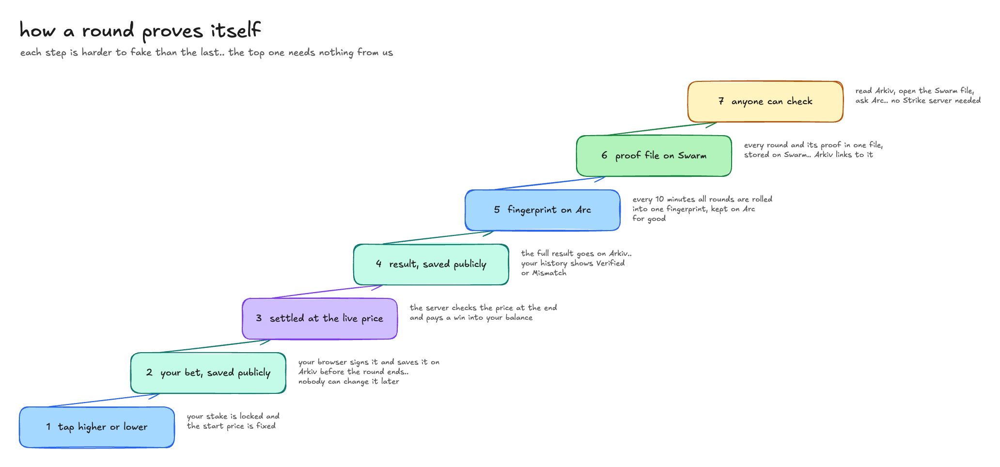

# how we use Arkiv

a fast game asks you to trust the house. Strike uses Arkiv so you don't have to.. every bet and every result is public, read only, and signed by someone you can name

## each Arkiv feature changes something you see

| Arkiv feature | what it does in Strike | where you see it |
|---|---|---|
| **read only entities** | a round's result can't be edited once it's sealed, not even by us | the history tab marks each round **Verified** or **Mismatch** against our own ledger |
| **owner is the writer** | your bets are written by your own browser key, so we can't change what you bet | "own a public record of every bet on Arkiv" on the trade page, one signature and no popups after |
| **query by attributes** | the trade page asks Arkiv for the last results on a market, and for bets still in play | "Recent rounds", **Everyone** view on the trade page: every player's results and the bets still in play, read straight from Arkiv, not our server |
| **query by creator** | every read filters on `$creator = addr(<operator>)`, so a copycat entity can't pass as a Strike result | a fake round never shows up as Verified |
| **expiry you choose** | bets live until an hour after their round, results about 6 months | in play lists clean themselves up, results stay long enough to dispute |
| **entities point to files** | each 10 minute batch has an entity whose `swarm` field points to the full proof file | "Every round + proof on Swarm" on any round's proof |

## the filters fit how people look things up

- **"show me my rounds"**: `wallet` and `betId`, both indexed. the history tab asks for exactly the rounds on screen
- **"what just happened on BTC"**: `asset` and `settledAt`, both indexed, so the trade page asks for one market's last 24 hours
- **"who else is betting right now"**: `asset` and `endTime > now` on `strike.bets`
- **"which batch is this round in"**: `epoch` and `root` on `strike.epochs`, the same root Arc stores

fields nobody filters on (stake, payout, prices) are stored but not indexed

## who can edit what

nobody. every entity is created with the read only flag, so there are no updates and no deletes, it only expires

- `strike.rounds` and `strike.epochs` are written by the Strike operator `0x0f05df479fcb23b2281e28813fb47e57e47d1bb7`. the app only trusts entities from that creator
- `strike.bets` are written by each player's browser key. the wallet signs one message to allow the key for 7 days, the backend sends the key a little testnet ETH for gas, and the signature is stored on every bet, so anyone can check that the wallet really allowed it

## why each expiry

| entity | lives | why |
|---|---|---|
| `strike.bets` | the round, plus 1 hour | it only matters while the round is in play. after that the sealed round carries the result |
| `strike.rounds` | about 6 months | long enough for anyone to check or dispute a result. it's close to the protocol's ceiling |
| `strike.epochs` | about 6 months | same window. after that the root stays on Arc for good, and the proof file stays on Swarm while its batch lasts |

## where the code is

- writing rounds and epochs: [`backend/crates/core/src/arkiv.rs`](../backend/crates/core/src/arkiv.rs). we build the `execute` call ourselves in Rust over JSON-RPC, in batches as rounds settle
- writing bets and reading them back: [`frontend/lib/arkivBets.ts`](../frontend/lib/arkivBets.ts)
- reading results in the browser: [`frontend/lib/arkiv.ts`](../frontend/lib/arkiv.ts), used by the history tab, the trade page and the round proof
