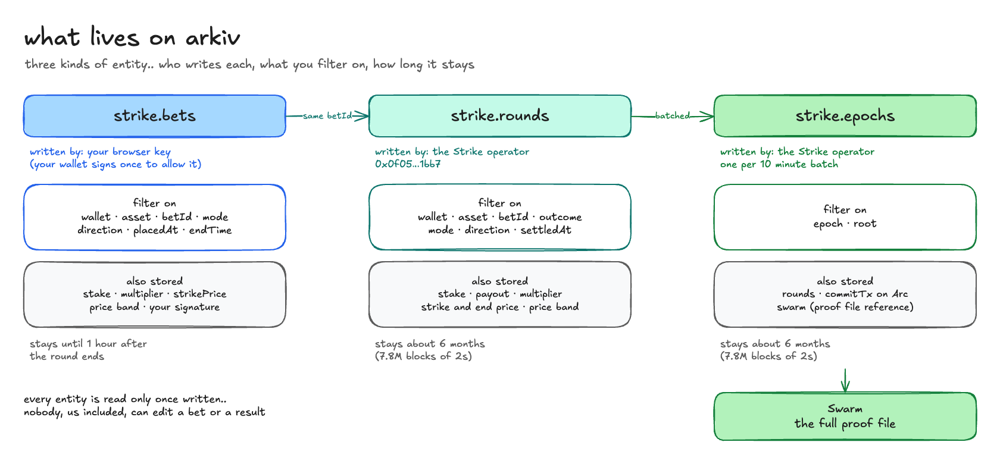

# schema

Strike writes three kinds of entity to Arkiv's Rabdi testnet (chain id `7794095`). every entity is created read only, so once it's written nobody can change it, us included

## strike.bets

a bet, written by the player before the round ends

| | |
|---|---|
| **owner** | the player's browser key. the wallet allows that key once with a signed message, and the signature rides on every entity, so anyone can check wallet, then key, then bet |
| **expires** | 1 hour after the round ends. long enough to show the bet while it's in play, after that the sealed round below is the record |
| **written by** | [`frontend/lib/arkivBets.ts`](../frontend/lib/arkivBets.ts) |

| field | type | indexed | what it is |
|---|---|---|---|
| `arkiv.schema` | string | yes | always `strike.bets` |
| `betId` | string | yes | the round's id, the same one `strike.rounds` uses |
| `wallet` | address | yes | the player's wallet |
| `asset` | string | yes | `BTC`, `ETH`, `NVDA`, `EUR` and so on |
| `mode` | string | yes | `binomo` (higher or lower) or `box` (price band) |
| `direction` | string | yes | `UP` or `DOWN` |
| `placedAt` | u64 | yes | when the bet was placed, ms |
| `endTime` | u64 | yes | when the round ends, ms |
| `stake` | decimal | | USDC or EURC staked |
| `multiplier` | decimal | | payout multiple |
| `strikePrice` | decimal | | the starting price |
| `priceTop`, `priceBottom` | decimal | | the band, for box rounds |
| `delegationR`, `delegationSV`, `delegationExpires` | string, u64 | | the wallet's signature allowing this key, and when it ends |

## strike.rounds

a settled round, the result

| | |
|---|---|
| **owner** | the Strike operator, `0x0f05df479fcb23b2281e28813fb47e57e47d1bb7` |
| **expires** | 7,800,000 blocks of 2s, about 6 months, just under the protocol's ceiling |
| **written by** | [`backend/crates/core/src/arkiv.rs`](../backend/crates/core/src/arkiv.rs), in batches as rounds settle |

| field | type | indexed | what it is |
|---|---|---|---|
| `arkiv.schema` | string | yes | always `strike.rounds` |
| `betId` | string | yes | joins to the player's `strike.bets` entity |
| `wallet` | address | yes | the player's wallet |
| `asset` | string | yes | the market |
| `mode` | string | yes | `binomo` or `box` |
| `direction` | string | yes | `UP` or `DOWN` |
| `outcome` | string | yes | `win`, `loss`, `tie`, `refund_no_price` (no price at the end, stake back) or `withheld` |
| `currency` | string | yes | `USDC` or `EURC` |
| `settledAt` | u64 | yes | when it settled, ms |
| `stake`, `payout`, `multiplier` | decimal | | the money |
| `strikePrice`, `endPrice` | decimal | | the starting and ending price |
| `priceTop`, `priceBottom` | decimal | | the band, for box rounds |

## strike.epochs

one batch of rounds, every 10 minutes

| | |
|---|---|
| **owner** | the Strike operator, `0x0f05df479fcb23b2281e28813fb47e57e47d1bb7` |
| **expires** | about 6 months, same as rounds. the long term record is the fingerprint on Arc and the file on Swarm |
| **written by** | [`backend/crates/core/src/arkiv.rs`](../backend/crates/core/src/arkiv.rs) (`archive_next`), after the batch is committed on Arc |

| field | type | indexed | what it is |
|---|---|---|---|
| `arkiv.schema` | string | yes | always `strike.epochs` |
| `epoch` | u64 | yes | the 10 minute window number |
| `root` | string | yes | the batch's fingerprint (Merkle root), the same value Arc stores |
| `rounds` | u64 | | how many rounds are in it |
| `commitTx` | string | | the Arc transaction that stored the root |
| `swarm` | string | | the Swarm reference of the full proof file, see [swarm.md](swarm.md) |

## the queries the app runs

| where you see it | query |
|---|---|
| history tab, Verified or Mismatch on each round | `arkiv.schema = str('strike.rounds') AND $creator = addr(<operator>) AND wallet = addr(<you>) AND (betId = str(..) OR ..)` |
| last results on a market, trade page | `arkiv.schema = str('strike.rounds') AND $creator = addr(<operator>) AND asset = str('BTC') AND settledAt > u64(<24h ago>)` |
| other players' bets in play, trade page | `arkiv.schema = str('strike.bets') AND asset = str('BTC') AND endTime > u64(<now>)` |
| one round's proof | `arkiv_getEntity(<key>)`, checked to be written by the operator |
