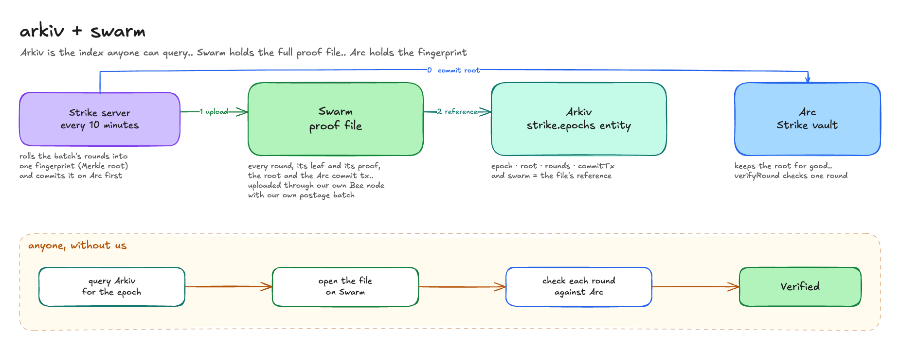

# Arkiv + Swarm

Strike settles thousands of short rounds. every 10 minutes the backend rolls that batch's rounds into one fingerprint (a Merkle root) and stores it on Arc. Arkiv entities expire, so the full evidence for each batch, every round with its leaf and its proof, lives on Swarm, and Arkiv indexes it



## what lives where

| where | what | written by |
|---|---|---|
| **Swarm** | one JSON proof file per batch: every round's fields, its leaf, its Merkle proof, the root, the Arc commit tx, the treasury address and the chain id | the Strike backend, through our own Bee node, stamped with our own postage batch |
| **Arkiv** | one `strike.epochs` entity per batch: `epoch`, `root`, `rounds`, `commitTx`, and `swarm`, the Swarm reference of the file | the Strike operator `0x0f05df479fcb23b2281e28813fb47e57e47d1bb7` |
| **Arc** | the batch's root, write once, in `StrikeTreasury.commitRounds`. `verifyRound(epoch, leaf, proof)` checks one round | the Strike treasury operator |

the field that holds the Swarm reference is **`swarm`** on `strike.epochs`

## one entity and the file it points to

- Arkiv entity: `0x59c5ddf06b5605e27833d0a02c8f6e96cebf9f334a6470b39e31eccb34895807` ([open in the explorer](https://rabdi.explorer.arkiv.network/entity/0x59c5ddf06b5605e27833d0a02c8f6e96cebf9f334a6470b39e31eccb34895807))
- Swarm reference: `d46b380493158dbbc9831e643ed1027fced49b310f25ad722f281dc21e3444ca`
- open the file: [api-strike.fastship.studio/swarm/bytes/d46b3804…44ca](https://api-strike.fastship.studio/swarm/bytes/d46b380493158dbbc9831e643ed1027fced49b310f25ad722f281dc21e3444ca). that's a read only route to our Bee node. any Bee node on Swarm testnet (network id 10) serves the same file at `/bytes/<reference>`

it's a real production batch: 18 rounds, root `0x26cc…cfdf`, committed on Arc

## postage batch and node

- batch ID: `3d19eb90c078fb99294443d0baf9ae4c64cb9057efd480dd3c3dcca6a266074c`
- bought by `0x3F294e62bf6f989Cb5c0EAe01108FdE291Ade397`, our Bee node's own wallet, in tx [`0x2f41c88b…`](https://sepolia.etherscan.io/tx/0x2f41c88bdc91ba55520cc4f415a89c2f217b34d4cc9322a862384e9e8b11e653) on Sepolia, paid in testnet sBZZ. depth 18, about 4.4 days at the price we bought it
- uploaded through our own Bee 2.8.3 light node on Swarm testnet (network id 10, Sepolia), running as a service next to the Strike backend on EC2. only `GET /bytes/<reference>` is public, the rest of the node's API stays on localhost

## files

| file | what it does |
|---|---|
| [`backend/crates/core/src/arkiv.rs`](../backend/crates/core/src/arkiv.rs) | `archive_next` and `swarm_upload`: uploads the file with `POST /bytes` and the `swarm-postage-batch-id` header, then writes the `strike.epochs` entity with its reference |
| [`backend/crates/core/src/proofs.rs`](../backend/crates/core/src/proofs.rs) | `epoch_bundle`: builds the file, and the committer that stores the root on Arc |
| [`frontend/components/game/OnchainProof.tsx`](../frontend/components/game/OnchainProof.tsx) | reads it in the app: "Every round + proof on Swarm" on any round's proof |
| [`scripts/verify-epoch.mjs`](../scripts/verify-epoch.mjs) | checks a batch without us: the Arkiv entity, then the Swarm file, then `verifyRound` on Arc for every round |

## run one upload and one read yourself

you need a Bee node on Swarm testnet with a usable postage batch (a light node and a few testnet sBZZ), or use the read route above for the read half

1. set `SWARM_BEE_URL=http://127.0.0.1:1633` and `SWARM_BATCH_ID=<your batch>` in `.env.local`, then start the backend
2. play one round. about 11 minutes later its batch is committed on Arc, and within 30 seconds the backend uploads the file and writes the `strike.epochs` entity. the log line is `archived epoch N as <entity>, bundle on swarm <reference>`
3. read it: `curl $SWARM_BEE_URL/bytes/<reference>` returns the JSON. its `root` equals the entity's `root` and `StrikeTreasury.roundRoots(epoch)` on Arc
4. or check the whole thing in one go:
   ```bash
   cd frontend && npm ci && cd ..
   node --experimental-strip-types scripts/verify-epoch.mjs 0x59c5ddf06b5605e27833d0a02c8f6e96cebf9f334a6470b39e31eccb34895807
   ```
   you should see every round with `leaf rebuilt: true | verifyRound: true`, then `Verified`

## in the demo video

after a round settles, the video opens its proof, then "Epoch on Arkiv", then "Every round + proof on Swarm", and the proof file opens straight from Swarm

## what got in our way

- **faucets at a venue.** the Sepolia PoW faucet allows one session per IP, and the whole hackathon shares one IP. we got testnet ETH from ETHGlobal's faucet instead
- **the public gateway can't do this bonus.** `api.gateway.ethswarm.org` stamps uploads with its own batch and ignores `swarm-postage-batch-id`, so you can't name your batch. it also serves mainnet, so testnet references don't open there. that's why we run our own node and our own read route
- **a fresh light node takes hours to sync.** it has to read every postage event since the contract was deployed before it accepts its own batch. that took about 2 hours, with the free Sepolia RPCs rate limiting it along the way
- **`--postage-stamp-start-block` crashes the node.** starting the sync from a recent block makes it fail on top ups of batches it never saw (`get batch …: storage: not found`) and shut down. a "start here and skip unknown batches" mode would save hours
- **buying a batch needs a synced node.** `POST /stamps` answers `503 syncing in progress`, so we bought the batch straight from the PostageStamp contract with the node's key
