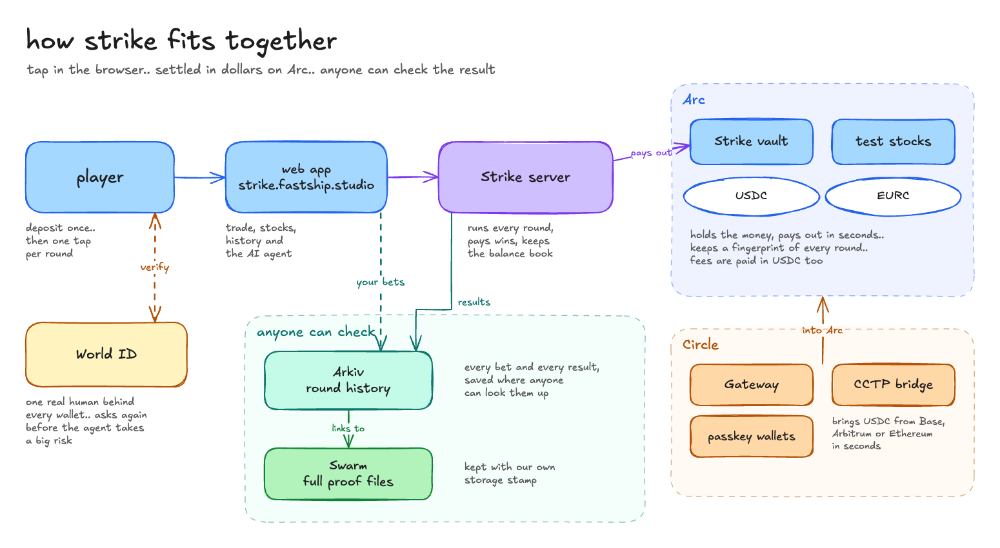
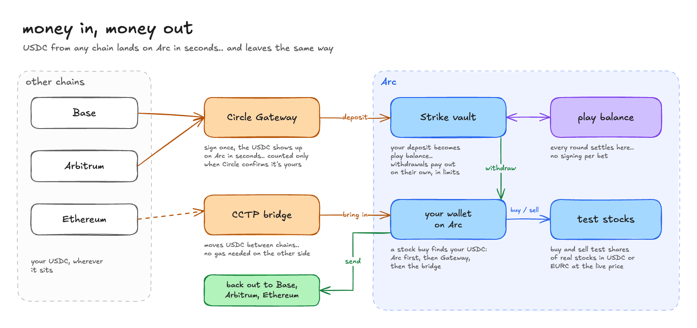
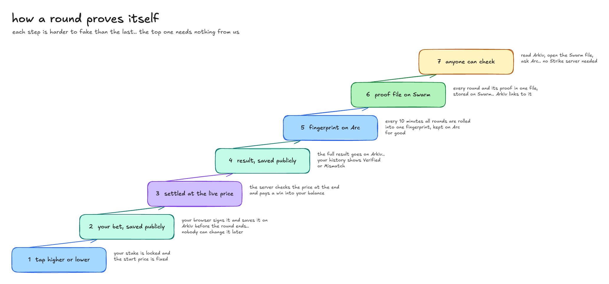

# Strike on Arc

**bounty: Best DeFi / Onchain Finance App Built End to End in Arc Studio**

Strike is a trading app on Arc. you call higher or lower on crypto, forex, stocks and metals in rounds of 5 seconds to 1 minute, settled in USDC or EURC. you can also buy and sell test shares of real stocks at the live price. money comes in from any chain through Circle, the vault on Arc pays wins in seconds, and every result is checkable by anyone

## for reviewers

| | |
|---|---|
| Arc Studio project | [studio.arc.io/app/3466b6f3-8cdb-436f-a47b-2eb0d379c4dd](https://studio.arc.io/app/3466b6f3-8cdb-436f-a47b-2eb0d379c4dd) |
| live app | [strike.fastship.studio](https://strike.fastship.studio), deployed on **Arc testnet** (chain id `5042002`) |
| check any round | [strike.fastship.studio/verify](https://strike.fastship.studio/verify) |
| repo | [github.com/TryStrike/strike](https://github.com/TryStrike/strike) (MIT) |
| builder | [github.com/ayuxy027](https://github.com/ayuxy027) |
| vault | `StrikeTreasury` [`0x8726144B6a122862B9F1184752d8ebA0AcD662B6`](https://explorer.testnet.arc.io/address/0x8726144B6a122862B9F1184752d8ebA0AcD662B6) |
| stocks | `TestStockMarket` [`0xd9f98f3b268e788f3ccf6e7ced2d592a84a6f80f`](https://explorer.testnet.arc.io/address/0xd9f98f3b268e788f3ccf6e7ced2d592a84a6f80f) |

### example transactions on Arc testnet

| what | tx |
|---|---|
| vault deployed | [`0x749c4719…0c9a`](https://explorer.testnet.arc.io/tx/0x749c4719ac51f88c9ac43dea2c800712b1fb26e9e149835d3aad792fe7700c9a) |
| payout caps set (`setCap`) | [`0xaa3ed769…94c6`](https://explorer.testnet.arc.io/tx/0xaa3ed769060dc890fa4b58d5e92a922e8681ed315b3fdd78a45fae15545694c6) |
| a win paid out in USDC (`payout`) | [`0x9e98fd2e…5465`](https://explorer.testnet.arc.io/tx/0x9e98fd2ebea3c4518f31843fee79102fdc7f034c0f23a413e954143c08935465) |
| a 10 minute batch of rounds committed (`commitRounds`) | [`0xb51687e2…5712`](https://explorer.testnet.arc.io/tx/0xb51687e2490c4b9947674915480a950e11c80980f14ec1a49f3b4bc505dc5712) |
| stock market deployed | [`0x1d5f7bc4…68ca7`](https://explorer.testnet.arc.io/tx/0x1d5f7bc4eb75491110d70ebfcb757a40abe7b1471bc72b3aef96ef3989c68ca7) |
| test shares bought (`buy`) | [`0xb98db2c4…5ad2`](https://explorer.testnet.arc.io/tx/0xb98db2c4d1581d0aabeff04ac0a605350b07d5b78e3c9cf2fb700b09ea445ad2) |
| test shares sold (`sell`) | [`0x9b3a80f8…f310`](https://explorer.testnet.arc.io/tx/0x9b3a80f89fae7472748f730296472549351eaf644b2433340b40d91361e9f310) |

## why Arc

- **dollars are the gas.** USDC pays for every transaction on Arc, so a player only ever holds one asset. on other chains they'd need ETH just to withdraw a win
- **fast, final settlement.** a 5 second round only works if a payout is final in about a second. Arc's deterministic finality means a paid win can't be reorged away
- **Circle's money is native.** USDC, EURC, Gateway and CCTP are first party on Arc, so money from Base, Arbitrum or Ethereum lands in the vault without a third party bridge, and euros are a real second currency, not a wrapped token
- **predictable fees.** fees are priced in dollars and stay low, so committing a fingerprint every 10 minutes costs cents, not a gas auction

## architecture



| part | what it is | code |
|---|---|---|
| web app | Next.js 16, wagmi and viem. trade, markets, stock pages, history, the AI agent | [`frontend/`](../frontend) |
| Strike server | Rust (axum) over a single writer SQLite ledger. settles every round from live prices, pays out inside caps, signs stock quotes, commits round fingerprints to Arc | [`backend/`](../backend) |
| Strike vault | `StrikeTreasury` on Arc: holds USDC and EURC, pays out with caps, keeps the round fingerprints | [`contracts/StrikeTreasury.sol`](../contracts/StrikeTreasury.sol) |
| test stocks | `TestStockMarket` on Arc: buy and sell test shares at a quote the server signs | [`contracts/TestStockMarket.sol`](../contracts/TestStockMarket.sol) |

## contracts on Arc testnet

chain id `5042002`, explorer [explorer.testnet.arc.io](https://explorer.testnet.arc.io)

| contract | address | deploy tx |
|---|---|---|
| `StrikeTreasury` | [`0x8726144B6a122862B9F1184752d8ebA0AcD662B6`](https://explorer.testnet.arc.io/address/0x8726144B6a122862B9F1184752d8ebA0AcD662B6) | [`0x749c4719…0c9a`](https://explorer.testnet.arc.io/tx/0x749c4719ac51f88c9ac43dea2c800712b1fb26e9e149835d3aad792fe7700c9a) |
| `TestStockMarket` | [`0xd9f98f3b268e788f3ccf6e7ced2d592a84a6f80f`](https://explorer.testnet.arc.io/address/0xd9f98f3b268e788f3ccf6e7ced2d592a84a6f80f) | [`0x1d5f7bc4…68ca7`](https://explorer.testnet.arc.io/tx/0x1d5f7bc4eb75491110d70ebfcb757a40abe7b1471bc72b3aef96ef3989c68ca7) |
| USDC | `0x3600000000000000000000000000000000000000` | |
| EURC | `0x89B50855Aa3bE2F677cD6303Cec089B5F319D72a` | |
| CCTP `TokenMessengerV2` | `0x8FE6B999Dc680CcFDD5Bf7EB0974218be2542DAA` (Arc domain 26) | |

owner and operator: `0xc0368D6Ec4586B9F96b379a9584ae05E0d31fD28`

both contracts are tested with Foundry ([`contracts/test`](../contracts/test), `forge test` from the root). addresses, ABIs and caps live in [`contracts/deployments/`](../contracts/deployments)

## money in, money out



| Circle product | how Strike uses it | code |
|---|---|---|
| **USDC** | the game's currency and Arc's gas, so a player only ever holds dollars | everywhere |
| **EURC** | play and buy stocks in euros, priced at the live EUR/USD rate | [`backend/crates/core/src/markets.rs`](../backend/crates/core/src/markets.rs) |
| **Gateway** | one USDC balance across chains. a stock buy pulls from it and mints on Arc in seconds | [`frontend/lib/gateway/`](../frontend/lib/gateway) |
| **CCTP via Bridge Kit** | brings USDC in from Base, Arbitrum or Ethereum Sepolia, and sends it back out. Circle's Forwarder pays the gas on the other side | [`frontend/lib/bridge/cctp.ts`](../frontend/lib/bridge/cctp.ts) |
| **CCTP from the vault** | the vault can pay a winner straight onto another chain (`payoutCrossChain`) | [`contracts/StrikeTreasury.sol`](../contracts/StrikeTreasury.sol) |
| **Modular Wallets** | sign in with a passkey, no extension: a Circle smart account on Arc | [`frontend/lib/wallet/passkey.ts`](../frontend/lib/wallet/passkey.ts) |

a stock buy finds your USDC wherever it is: your Arc wallet first, then your Gateway balance, then a bridge from another chain ([`frontend/lib/gateway/usdcSources.ts`](../frontend/lib/gateway/usdcSources.ts))

## how the money stays safe

- **two roles in the vault.** the owner sets the caps and can sweep. the operator (the server's key) can only pay out and commit fingerprints
- **caps on every payout.** 1,000 per transaction and 10,000 per day, per token. no cap set means nothing can be paid
- **deposits are checked on Arc.** the server credits a deposit only after reading the token transfer into the vault from Arc itself
- **withdrawals pay out on their own,** inside the caps, and every payout carries the bet or withdrawal id onchain
- **stock quotes can't be replayed.** each quote is signed for one token, one symbol and one price, and expires in 2 minutes. a tampered price, a wrong symbol, an expired quote, selling more than you hold and paying in the wrong token are all refused onchain
- **either role can pause,** only the owner resumes

## every round is checkable



every 10 minutes the server rolls that batch's settled rounds into one fingerprint (a Merkle root) and stores it in the vault with `commitRounds`. it's write once. anyone can then check a single round with `verifyRound(epoch, leaf, proof)`. the results themselves are public on Arkiv, and the full proof file is on Swarm, see [arkiv/](../arkiv)

## built for reuse

we pulled the vault out into its own template so other builders can drop it in: [arc-provable-vault](https://github.com/TryStrike/arc-provable-vault) (MIT). it's `StrikeTreasury` made general: any token with per transaction and per day payout caps, an owner and an operator, write once Merkle batch commits with on-chain verification, and CCTP payouts to other chains. 102 Foundry tests, fuzzing and reentrancy cases included, plus a deploy script and a guide to building the Merkle tree off chain

## built in Arc Studio

the contracts went through [our Studio project](https://studio.arc.io/app/3466b6f3-8cdb-436f-a47b-2eb0d379c4dd). in Studio we:

- wired the treasury into Studio's Contracts panel and set up Foundry for it
- had Studio write the treasury's Foundry tests (caps, batch payouts, CCTP payouts, Merkle commits and proofs, pause, access control), 52 passing at the time, and they grew into [`contracts/test`](../contracts/test)
- deployed the first version of the vault to Arc testnet from Studio: [`0xea76bc5a…9871`](https://explorer.testnet.arc.io/address/0xea76bc5a87114d8a6a85f4dfd6c48c5e688a9871), tx [`0x4175fd88…b4e2`](https://explorer.testnet.arc.io/tx/0x4175fd886d39000d8d2e1bf25cfcc4e092d2cae2c204717a1f6744d6c4b1b4e2)
- ran the app in Studio's preview

the live `StrikeTreasury` is the next version of that contract, deployed from the operator wallet. the first vault was swept and paused when we moved over ([`contracts/deployments/`](../contracts/deployments)). the Rust settlement server, the Arkiv and Swarm proof trail and World ID were built outside Studio

## run it

```bash
cp .env.example .env.local
(cd frontend && npm install)
cargo run --manifest-path backend/Cargo.toml -p server    # API on 127.0.0.1:8080
cd frontend && npm run dev                                # app on http://localhost:3000
```

free test USDC at [faucet.circle.com](https://faucet.circle.com)
